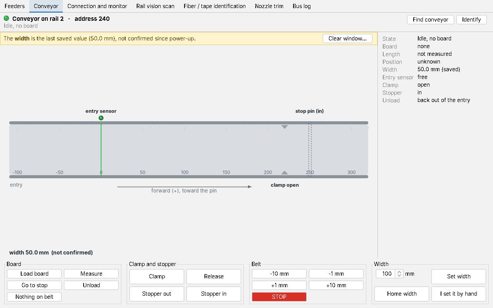
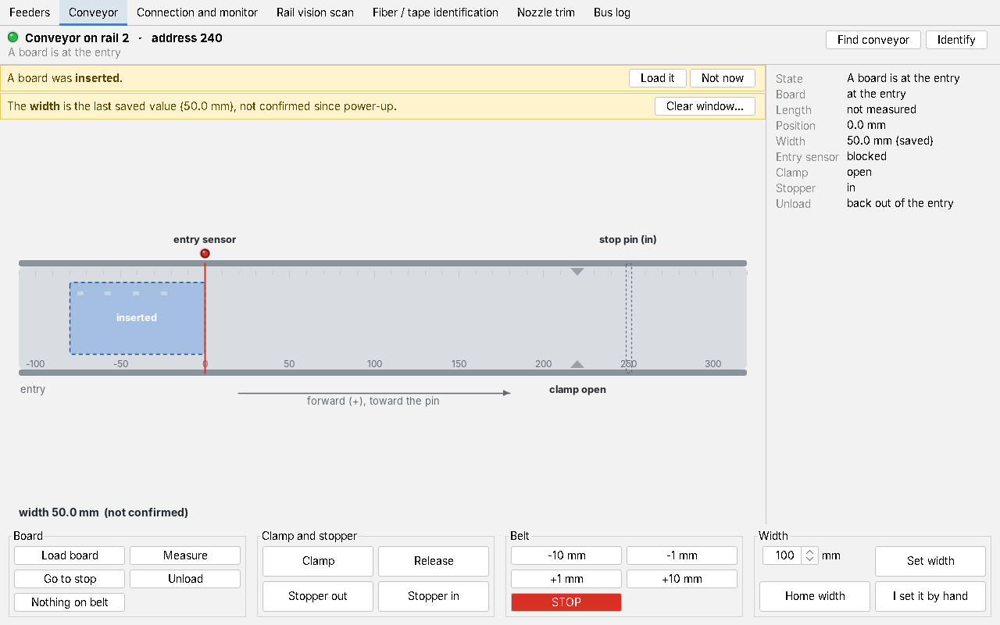
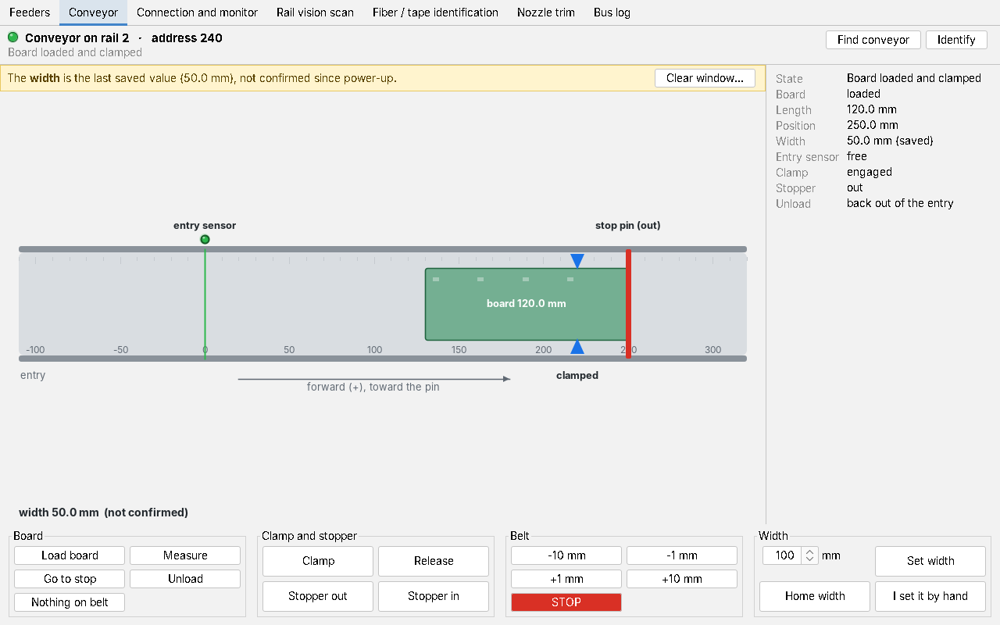
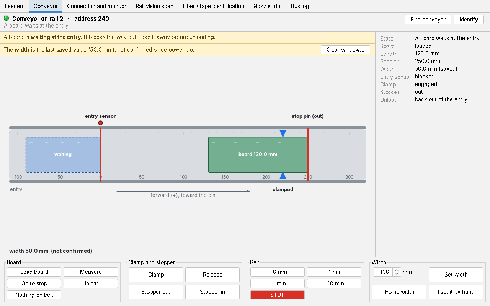

# Conveyor on the host (OpenPnP fork, branch orion-feeder)

Implemented against a simulated controller (`SimulatedConveyor`), 14 unit tests. The real firmware does not exist yet.

- **Bus**: the conveyor is a device of kind CONVEYOR at the fixed address 240 on rail 2 (rail number is a setting).
  A rail scan asks that address; the monitor pings it like a feeder and reads its status every sweep. Feeders never get an
  address above 239, and the conveyor never appears as a feeder (no tile, no OpenPnP feeder is created for it).
  A silent conveyor never triggers the bus reset (only silent feeders do).
- **Tab**: *Conveyor* in the feeder bus manager. The belt is drawn from above (entry sensor, stop pin, clamp cams, rail
  width, loaded board gliding to its position, a board waiting at the entry). Prompts: board inserted (Load it / Not now),
  board waiting (and whether it blocks the way out), width not confirmed (Clear window...). Controls by group: Board,
  Clamp and stopper, Belt (jog, STOP), Width (set, home, I set it by hand). Width actions go through the clear window.
- **Message**: a board inserted with nothing loaded also raises a message in the main window with **Load it**.
- **Not a machine task**: conveyor actions run on their own worker, so they work while a job runs.
- `ConveyorView` draws from a `ConveyorStatus` only, so it can be placed in a whole-machine overview later (feeder tiles
  are the same kind of component).

