# Orion UI refresh: audit, before / after

Branch `orion-feeder` of `TheIgorMC/openpnp_orion`. All screenshots come from the same program (a real Swing window
with a simulated bus of 20 feeders on 2 rails), once on the old code (`88a84a6`) and once on the new one.
The font in the capture machine draws round brackets like curly ones; that is a screenshot artefact, not a text change.

## 1. Usability audit of the old screens

| Screen | Problem |
|---|---|
| Bus manager window | One table row per feeder with 10 columns (serial cut off, "Comp" shows 65535 for unset). Only about 5 feeders visible: the connection form and the vision settings took two thirds of the window. |
| | Status line ran off the window ("...1 with problems. NOT VERIFIED..." clipped at the left and right edge). |
| | Everything stacked on one page: connection form, 4 rows of vision spinners, table, 2 rows of buttons. No hierarchy, no hint what to press first. |
| | Connect / Disconnect / Scan sat in the middle of a settings form. |
| | A feeder that was unplugged stayed "ONLINE" until somebody pressed Scan or Ping. No automatic detection at all. |
| | No way to recover a hung bus except re-plugging the adapter. |
| | Buttons acted on a table selection that was easy to lose; Feed / Peel looked enabled for lost units. |
| Debug tab | Separate top-level tab, named like a developer tool; not reachable from the menu. |
| Orion menu | Three items with no state: no idea if connected, no way to scan or disconnect, no mention of the log. |
| Launcher under feeder list | Three buttons incl. Disconnect right next to the safe one; status as text only ("Rail 1: 6 unit(s), 6 online, NOT verified by vision" in one run-on line). |
| Feeder tab | "Live control" and jog buttons were at the very bottom behind about 1000 px of settings. The slot row was wider than the panel (checkbox text cut off). The long tape-check section had a clipped last row. Two big vision sections were always open even when switched off. |
| Wording | "Comp", "Peel per feed", "Bus Manager" / "Debug" naming differed between window, menu and launcher. |

## 2. What changed

* **Bus manager**: tile grid. Each feeder is a small rectangle with its address, component and an LED
  (green answers, red no answer, amber needs a look, blue corner = no OpenPnP feeder yet). Click a tile for the details
  panel (serial, part, tape width, slot X, last answer, Identify / Ping / Feed / Unfeed / Peel / Unpeel / Locate / Create / Forget).
  Double click blinks the unit. Settings moved to their own tabs (Connection and monitor, Rail vision scan, Fiber / tape
  identification, Nozzle trim, Bus log). Window is larger (1280 x 800) and the bus log lives in it as a tab.
* **Header bar**: connection light, "18 of 20 feeders answering", monitor status ("last ping sweep 2 s ago"),
  Connect / Disconnect, Scan all rails, Reset bus.
* **Bus monitor** (`OrionBusMonitor`, new): every 3 s (setting) it pings every known feeder with one silent PING (not in the log).
  A feeder is declared lost after two misses, turns red, a message appears; it turns green again when it answers.
  The same sweep sends a DISCOVER peek (without assigning) to see a feeder that has just been plugged in:
  message "Found 1 new feeder", the rail is scanned automatically after 30 s with no further feeder added
  (each new one restarts the 30 s). **Scan now** / **Not now** buttons on the message and on the rail view.
  Feeders that were only restarted (power dip) are recognised as such and restored after 5 s.
  The monitor does nothing while a job runs or the machine executes a task.
* **Bus reset**: nobody answers for 3 sweeps, or the adapter returns errors: the port is reopened (soft reset),
  after two soft resets the rails are power-cycled on the host board (never on a rail you switched off yourself),
  and if the adapter is gone the port is retried with a growing delay (2, 4, 8, 16, 30 s), so re-plugging the adapter
  is picked up by itself. Manual: header button **Reset bus** (soft / hard) and Orion > Recover the bus.
* **Orion menu**: live status lines on top, then "Feeder bus manager...", "Bus log and raw commands...", set up / scan / verify,
  a checkbox to switch monitoring off, Recover the bus, Disconnect. Mnemonics and tooltips.
* **Launcher**: connection light, one LED per feeder per rail (hover for address and part), 2 buttons.
* **Feeder tab**: live control and jog on top, slot row split in two, vision sections fold away when switched off.

## 3. Before and after

### Bus manager
| Before | After (a tile selected) |
|---|---|
| 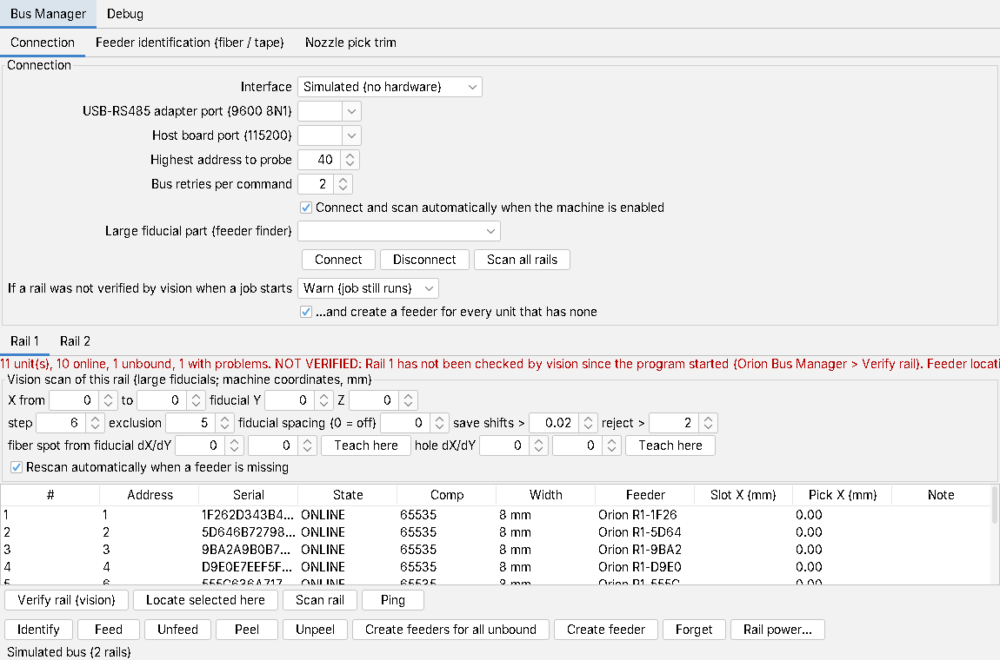 | 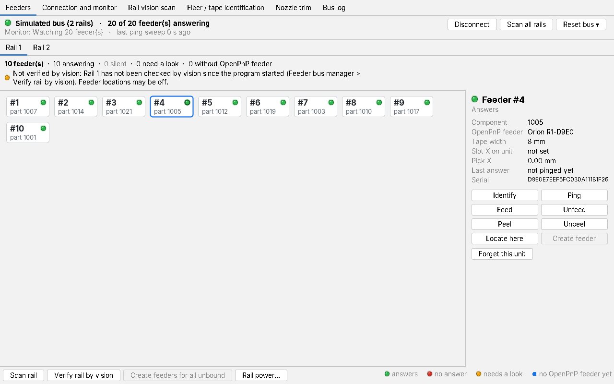 |

### A feeder is unplugged, a new one is plugged in (new)
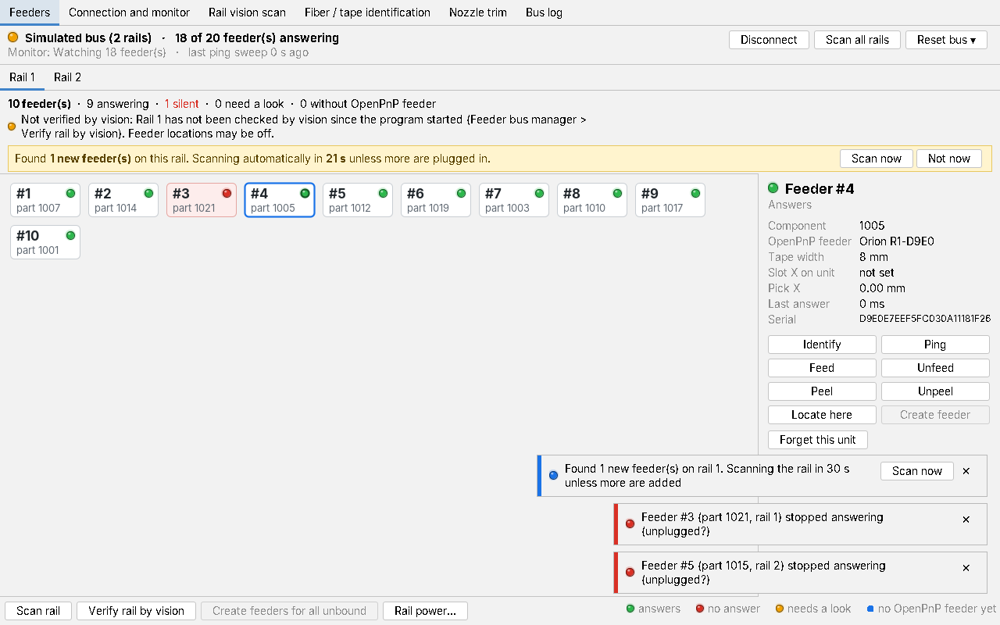

The three messages in the lower right are what appears over the main window. Full window: [after_toasts.png](img/after_toasts.png).

### Orion menu
| Before | After |
|---|---|
| 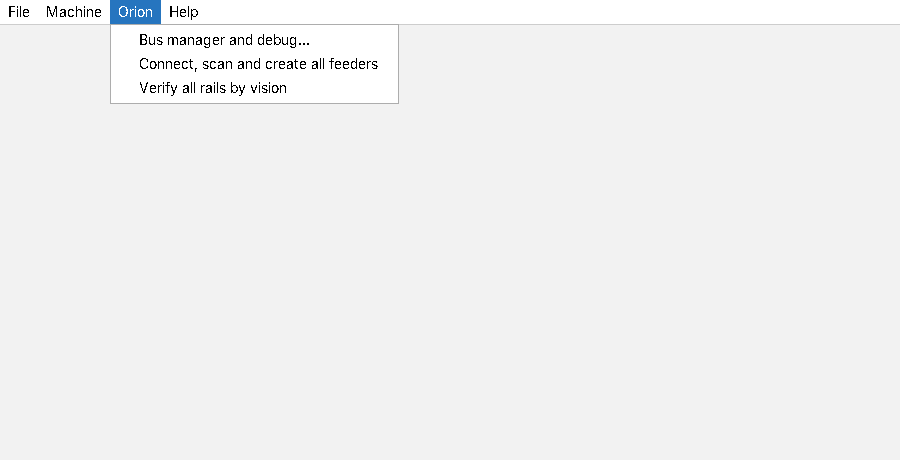 | 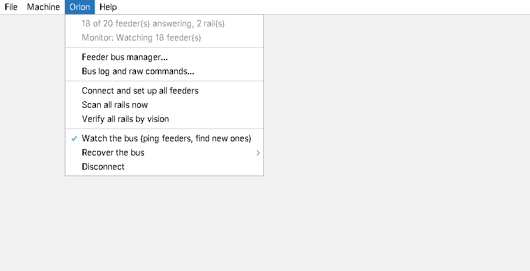 |

### Launcher under the feeder list
| Before | After |
|---|---|
| 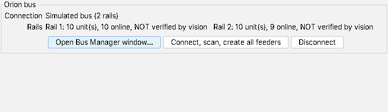 | 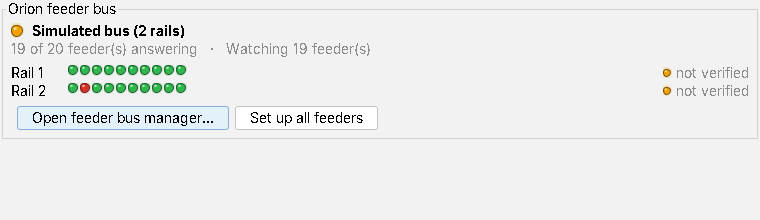 |

### Feeder tab
| Before | After |
|---|---|
| 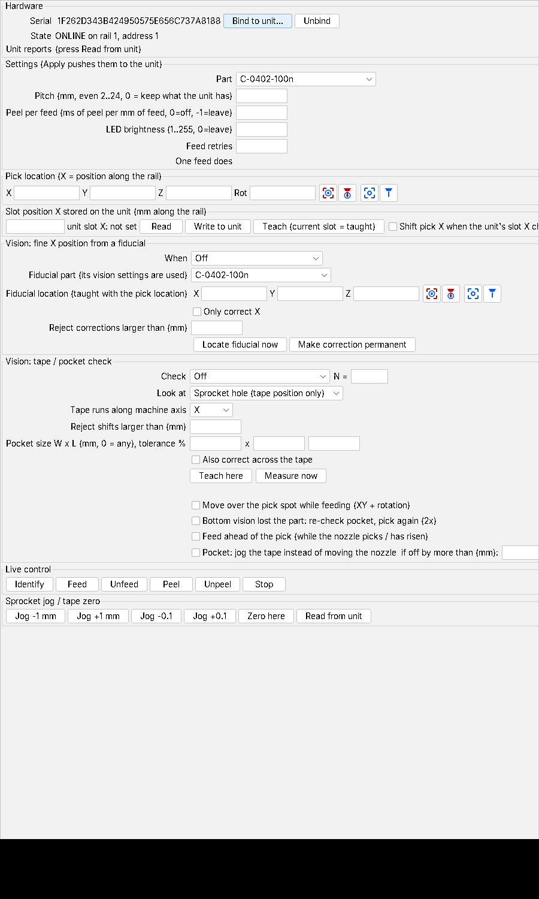 | 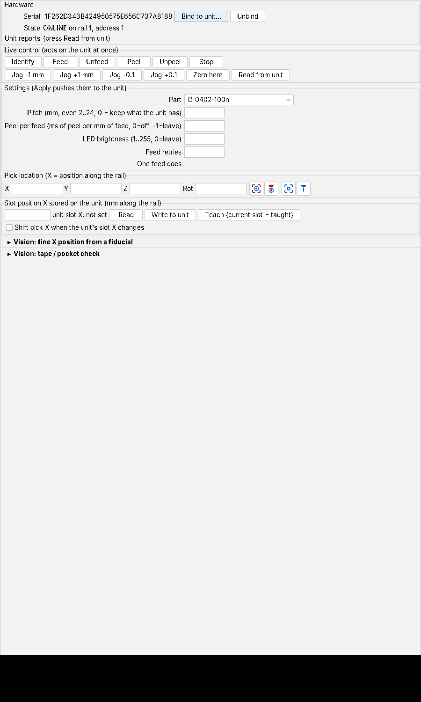 |

### Settings tabs
| Before: Connection | After: Connection and monitor |
|---|---|
|  | 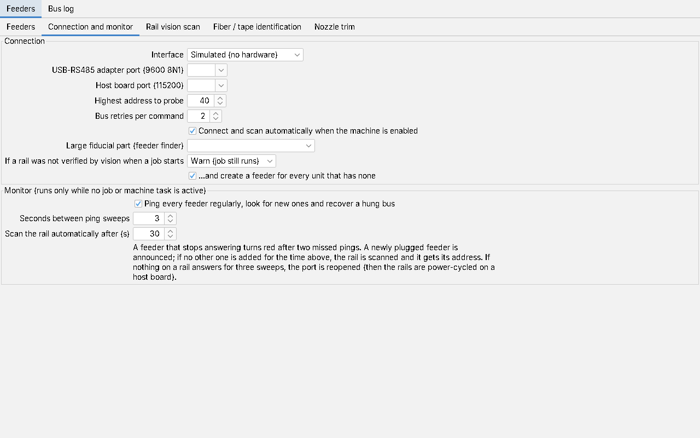 |

| Before: Debug | After: Bus log | After: Rail vision scan |
|---|---|---|
| 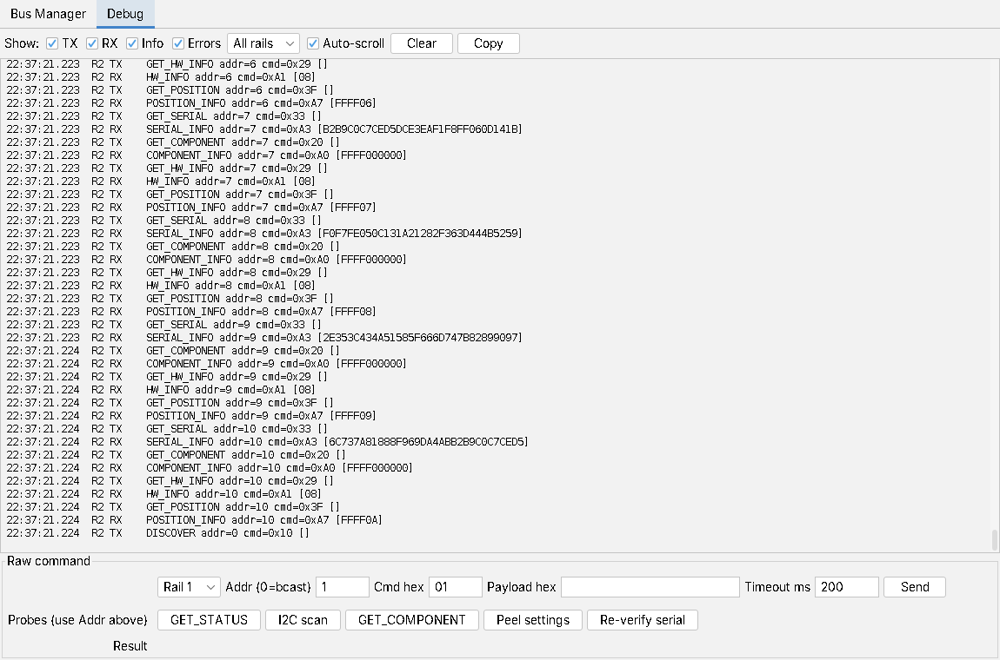 | 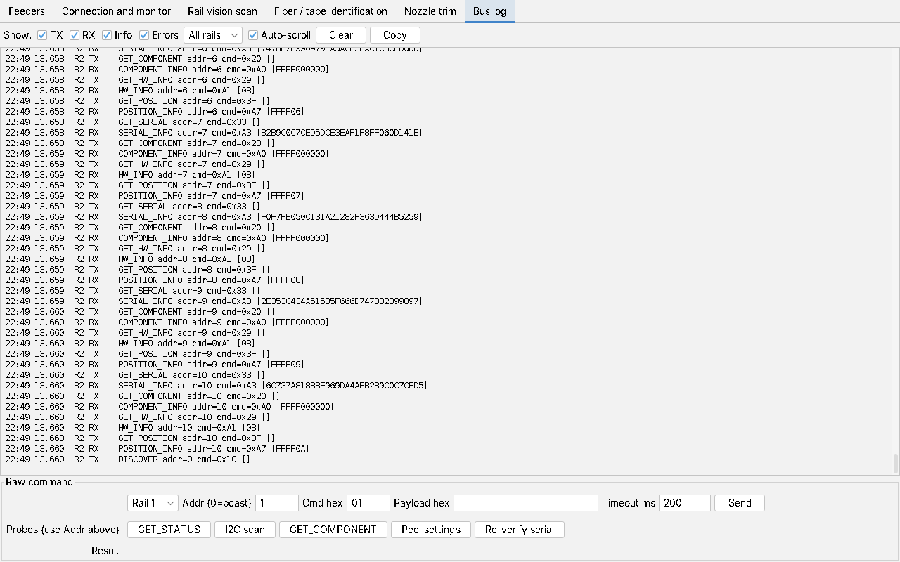 | 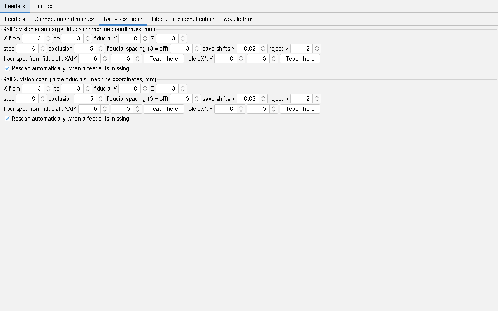 |

## 4. Tests

`OrionMonitorTest` (new, simulated bus): a ping keeps feeders online and records the round trip; an unplugged feeder is
lost after two misses and not after one; it turns green again; a peek sees a new feeder without assigning it; a restarted
feeder gets its old address back; monitor traffic is not logged; an adapter failure shows as a transport error and the
feeders recover after the port is reopened. All 79 Orion tests pass.
